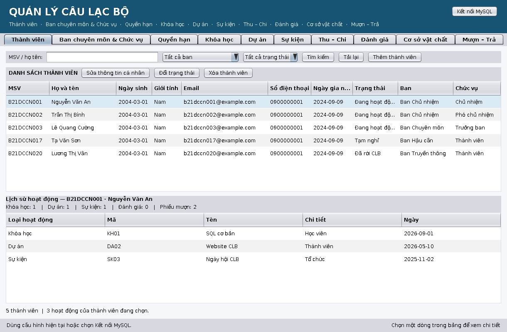

# Hướng dẫn làm giao diện Swing

Mục tiêu: cả 10 module cùng nằm trong **một cửa sổ chính, mỗi module một tab**. Bạn chỉ cần làm đúng một việc: viết màn hình (một `JPanel`) cho module của mình, dùng lại `Service` đã có. Không viết lại SQL, không đụng `Dao`.



## 1. Kiến trúc

```
app.Main ──(mặc định)──> app.SwingApp ──> ClubWorkspace (cửa sổ chính, 10 tab, nút Kết nối MySQL)
        └─(--console)──> app.MainMenu  (menu dòng lệnh cũ, giữ làm công cụ phụ)

ClubWorkspace  <──  app.SwingModules.all()  (danh sách 10 module, chỉ Tú sửa)
                      │  mỗi phần tử là một XxxSwingModule trong package của module
                      ▼
          XxxSwingModule.createPanel()  ──>  XxxSwingUi (JPanel)  ──>  XxxService  ──>  XxxDao  ──>  MySQL
```

- **Tab được tạo khi mở lần đầu.** Panel nào cài `common.Refreshable` thì được tự nạp dữ liệu ngay lúc đó, và được nạp lại khi người dùng bấm *Kết nối MySQL* để đổi CSDL.
- **Không sửa danh sách tab.** Tú đã đăng ký sẵn đủ 10 lớp `XxxSwingModule`. Module chưa làm đang hiện màn hình tạm (`PlaceholderPanel`). Bạn chỉ sửa lớp `XxxSwingModule` của mình (một dòng) và viết `XxxSwingUi`. Nhờ vậy các PR không xung đột.

## 2. Chạy thử

```bash
mvn compile exec:java                          # mở cửa sổ Swing (cần màn hình và MySQL đã chạy run_all.sql)
mvn compile exec:java -Dexec.args="--console"  # menu dòng lệnh cũ
mvn test                                       # test không cần MySQL, không cần màn hình
```

Cấu hình kết nối: biến môi trường `DB_URL`, `DB_USER`, `DB_PASSWORD`, hoặc file `src/main/resources/db.properties` (sao chép từ `db.properties.example`), hoặc nút **Kết nối MySQL** trong cửa sổ (chỉ giữ trong phiên chạy).

## 3. Công cụ có sẵn (`common/`)

| Lớp / hàm | Dùng để |
|---|---|
| `SwingSupport.model(cột...)`, `table(model, tên)`, `scroll(bảng)` | Tạo bảng chỉ đọc, có sắp xếp theo cột, đã định dạng sẵn |
| `SwingSupport.button(chữ, tên, hành động)` | Nút tự bắt `IllegalArgumentException` và hiện hộp thoại lỗi |
| `SwingSupport.form(nhãn[], ô...)` | Bố cục form hai cột (nhãn trái, ô nhập phải) |
| `SwingSupport.editor(...)` | Hộp thoại thêm/sửa: đọc form, lưu ở luồng nền, giữ nguyên form nếu lỗi |
| `SwingSupport.Tasks` | Chạy việc nặng (truy vấn MySQL) ở luồng nền, khóa nút khi đang chạy, báo lỗi tiếng Việt |
| `SwingSupport.confirm(...)`, `error(...)` | Hộp xác nhận xóa, hộp thoại lỗi |
| `SwingSupport.date(ô, nhãn, bắtBuộc)` | Đọc ngày `yyyy-MM-dd` từ ô nhập, báo lỗi dễ hiểu |
| `SwingSupport.text(giá trị)` | Hiển thị `null` thành "—" |
| `common.Refreshable` | Panel khai báo "đang bận" và "nạp lại từ đầu" |
| `common.PlaceholderPanel` | Màn hình tạm cho module chưa làm |

## 4. Làm một màn hình: 6 bước

1. **Mở màn hình mẫu** `src/main/thanhvien/ThanhVienSwingUi.java` (bảng chính + bảng chi tiết bên dưới) hoặc `khoahoc/KhoaHocSwingUi.java`. Sao chép sang package của bạn, đổi tên.
2. **Cài `common.Refreshable`**: `isBusy()` trả về `tasks.isBusy()`, `resetAndReload()` xóa bộ lọc và nạp lại.
3. **Thanh công cụ trên cùng:** ô tìm kiếm, nút *Tìm kiếm*, *Tải lại*, *Thêm...*. Mỗi hàng của bảng chính có các nút *Sửa*, *Xóa* ở phía trên bảng.
4. **Chỉ gọi `Service`, bao trong `tasks.run(...)`** (xem mục 5). Các hàm Service bạn có trong `docs/PHAN_CONG_SWING.md`.
5. **Thêm/sửa dùng `SwingSupport.editor(...)`**, xóa dùng `SwingSupport.confirm(...)` rồi `tasks.run(...)`.
6. **Nối vào cửa sổ:** trong `XxxSwingModule.createPanel()` đổi `return new PlaceholderPanel(...)` thành `return new XxxSwingUi(new XxxService());`.

Khung tối thiểu:

```java
public class XxxSwingUi extends JPanel implements Refreshable {
    private final XxxService service;
    private final DefaultTableModel model = SwingSupport.model("Mã", "Tên");
    private final JTable table = SwingSupport.table(model, "xxx.table");
    private final JLabel status = new JLabel(" ");
    private final SwingSupport.Tasks tasks = new SwingSupport.Tasks(this, status);
    private List<Xxx> rows = new ArrayList<>();

    public XxxSwingUi(XxxService service) {
        this.service = service;
        setName("xxx.panel");
        setLayout(new BorderLayout(10, 10));
        JPanel toolbar = new JPanel(new FlowLayout(FlowLayout.LEFT, 7, 0));
        toolbar.add(SwingSupport.button("Tải lại", "xxx.reload", this::reload));
        toolbar.add(SwingSupport.button("Thêm", "xxx.add", () -> edit(null)));
        add(toolbar, BorderLayout.NORTH);
        add(SwingSupport.scroll(table), BorderLayout.CENTER);
        add(status, BorderLayout.SOUTH);
    }

    @Override public boolean isBusy() { return tasks.isBusy(); }
    @Override public void resetAndReload() { reload(); }

    private void reload() {
        tasks.run("Đang tải...", service::danhSach, list -> {      // việc nặng ở luồng nền
            rows = list;                                            // phần này chạy lại trên luồng giao diện
            model.setRowCount(0);
            for (Xxx x : rows) model.addRow(new Object[] { x.ma(), x.ten() });
            status.setText(rows.size() + " dòng.");
        });
    }
    // edit(...): dùng SwingSupport.form + SwingSupport.editor(this, "Thêm", form, () -> new Xxx(...), service::them, this::reload)
}
```

## 5. Quy ước bắt buộc

- **Không gọi `Dao` trực tiếp.** Chỉ gọi `Service`; mọi kiểm tra dữ liệu vẫn nằm ở `Service` (đã có test).
- **Mọi truy vấn MySQL chạy trong `tasks.run(...)`**, không chạy trực tiếp trong `ActionListener`, nếu không cửa sổ sẽ đơ khi MySQL chậm. Phần "thành công" của `tasks.run` chạy lại trên luồng giao diện nên được cập nhật bảng, nhãn.
- **Đọc form ngay trên luồng giao diện** (trong tham số `read` của `editor`), ghi CSDL trong `save`.
- **Lỗi hiển thị bằng hộp thoại tiếng Việt** qua `SwingSupport`; không để lộ lỗi SQL hay `printStackTrace`.
- **Đặt tên component** theo mẫu `<module>.<thành phần>` (ví dụ `khoahoc.table`, `thanhvien.add`) để test tìm được.
- **Xóa luôn có hộp xác nhận.** Thông báo nói rõ điều kiện xóa (ví dụ "chỉ xóa được khi ban còn trống").
- **Ô ngày nhập dạng `yyyy-MM-dd`**, dùng `SwingSupport.date`. Giờ thì tự viết hàm đọc trong package của bạn; không sửa `common/`.
- **Không dùng thư viện mới** (không thêm vào `pom.xml`). Nếu thật sự cần, tạo Issue cho Tú.
- **Chỉ sửa trong package module của bạn.** Cần đổi `common/`, `app/`, `config/`, `pom.xml` hoặc schema thì tạo Issue cho Tú.

## 6. Kiểm thử

- **Test tự động không cần MySQL, không cần màn hình:** dùng `Dao` giả như `src/test/thanhvien/ThanhVienSwingUiTest.java`: dựng panel, gọi `resetAndReload()`, chờ bảng đầy, kiểm tra nội dung. Mỗi màn hình có ít nhất 2 test (nạp dữ liệu; bộ lọc hoặc chọn dòng).
- **Kiểm tay trên MySQL thật** (bắt buộc trước khi mở PR), tick vào danh sách trong PR: nạp được dữ liệu, thêm hợp lệ, thêm sai báo lỗi tiếng Việt, sửa, xóa có xác nhận, xóa bị chặn có thông báo, đổi kết nối MySQL thì bảng nạp lại, cửa sổ không đơ khi đang tải.
- **Chụp ảnh màn hình** (tab chính, hộp thoại thêm, một lỗi) vào `docs/bao-cao/anh/NN_ten-module/` để đưa vào báo cáo.

## 7. Lỗi hay gặp

| Triệu chứng | Nguyên nhân thường gặp |
|---|---|
| Cửa sổ đơ vài giây | Gọi `service...` ngoài `tasks.run` |
| `IllegalStateException`/`HeadlessException` khi chạy test | Mở `JFrame`/`JDialog` trong test; test chỉ nên dựng `JPanel` |
| Bảng không cập nhật sau khi lưu | Quên truyền `this::reload` làm tham số `onSaved` của `editor` |
| Tiếng Việt hiện `?` trên console | Chạy `chcp 65001` hoặc dùng cửa sổ Swing (không bị lỗi này) |
| `NullPointerException` khi cột trống | Hiển thị bằng `SwingSupport.text(giá trị)` thay vì gọi `toString()` |
| Chọn dòng khác nhưng chi tiết không đổi | Bỏ qua sự kiện chọn khi `tasks.isBusy()`; sau khi nạp xong, kiểm tra dòng đang chọn có còn đúng không (xem `ThanhVienSwingUi.loadHistory`) |
