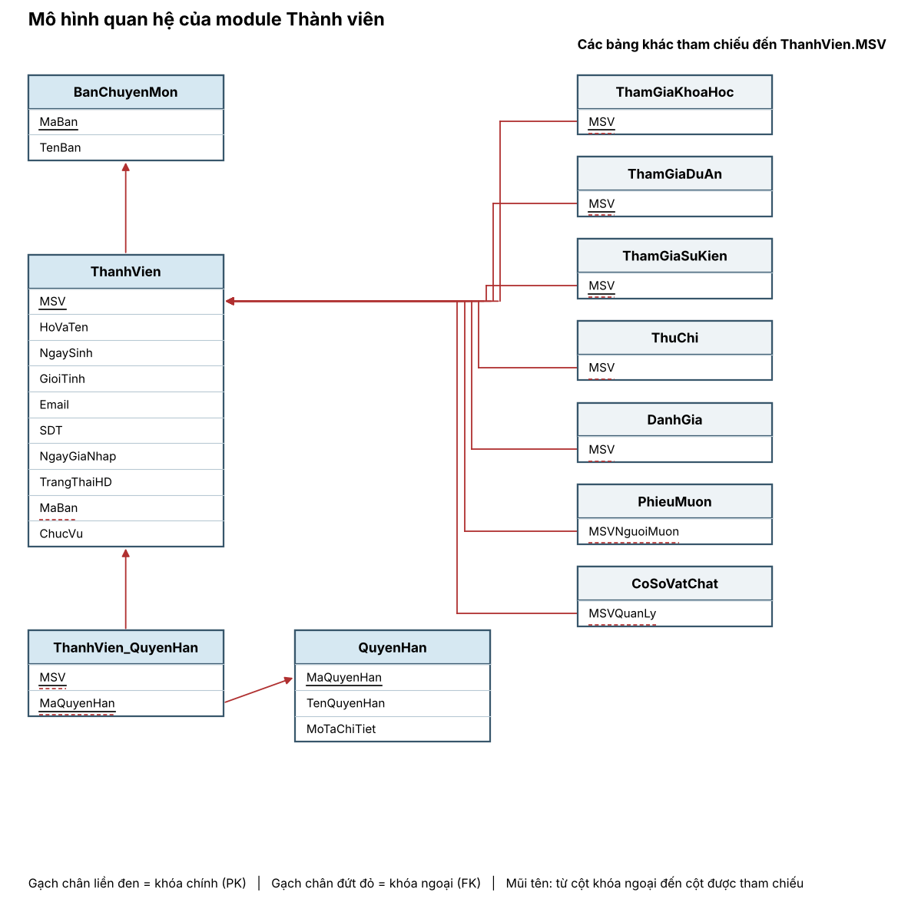
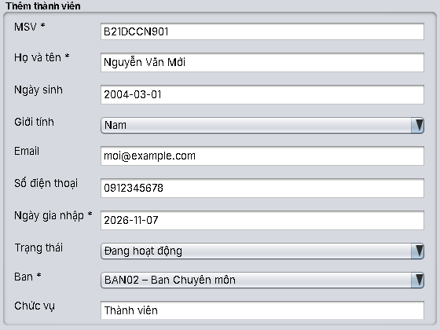
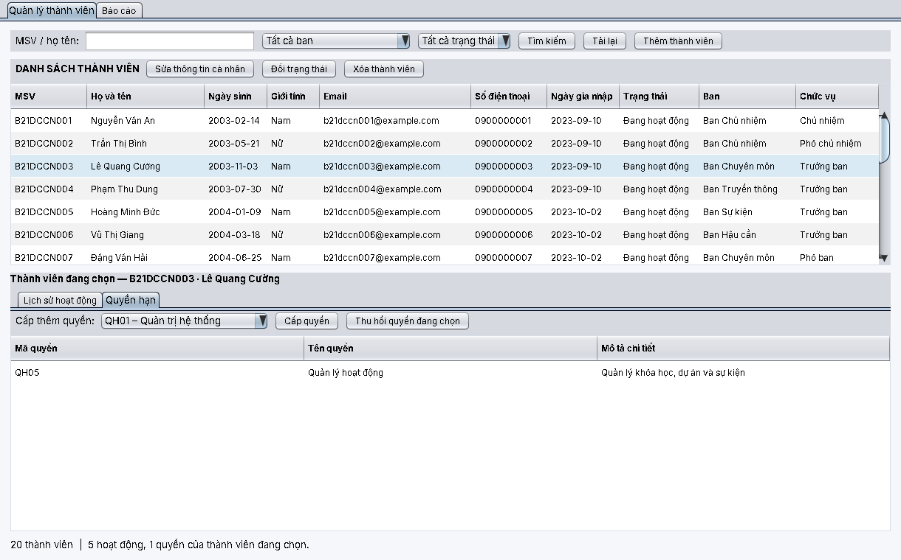
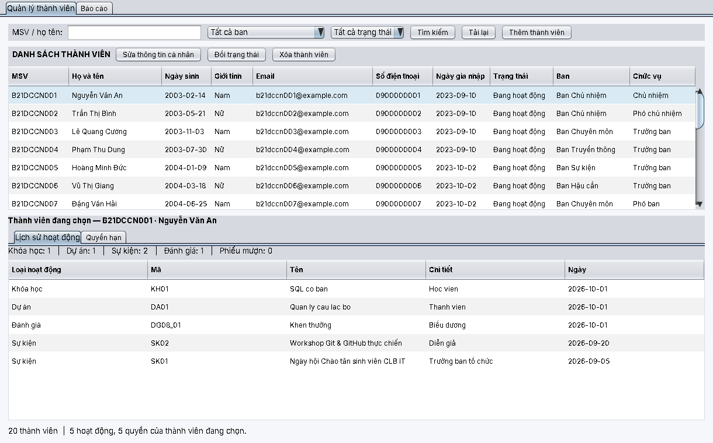
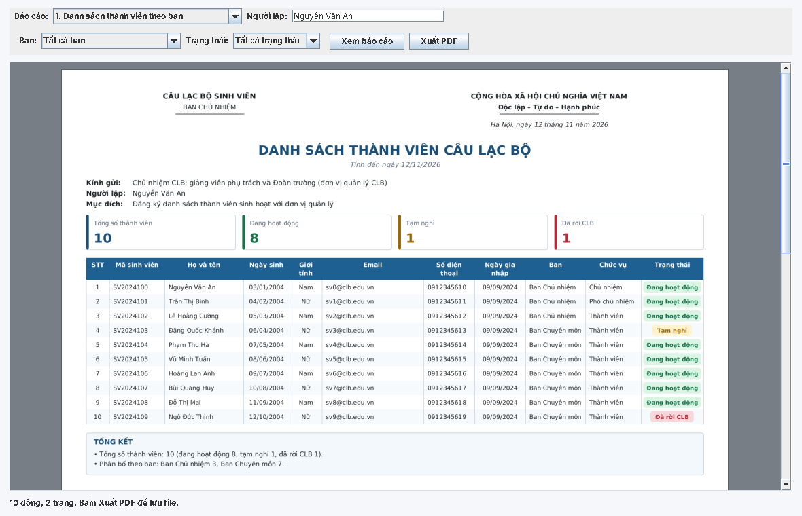
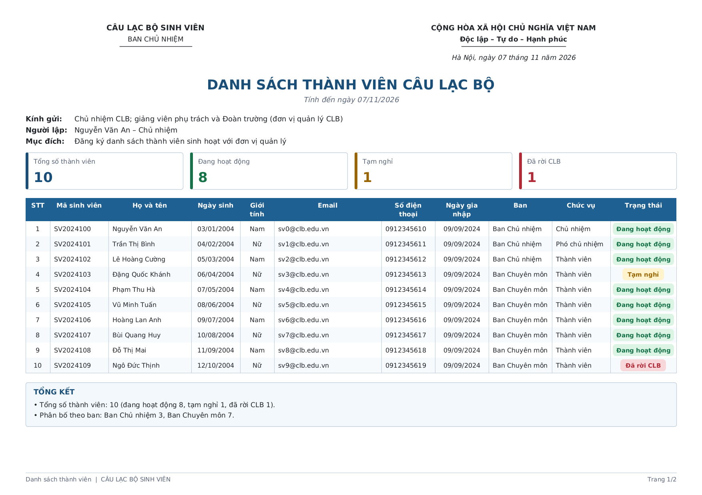
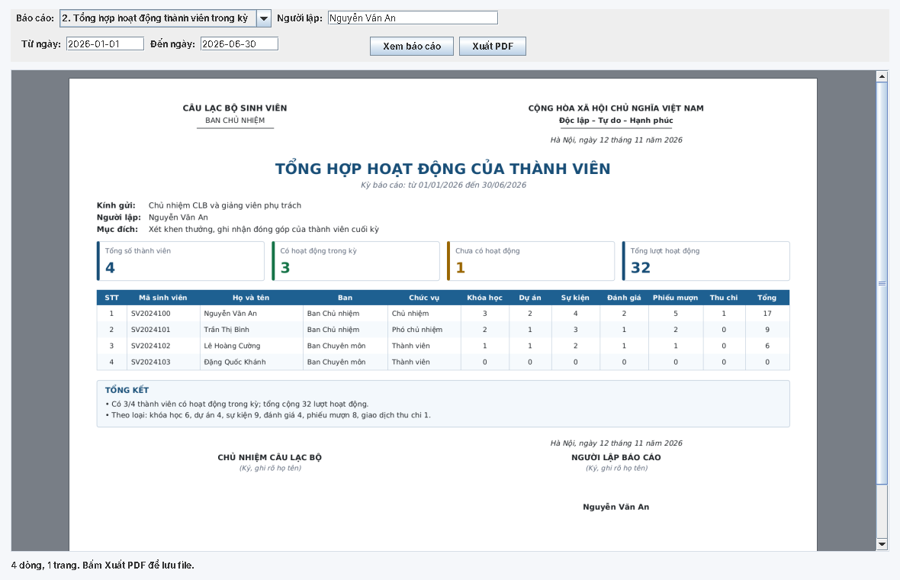
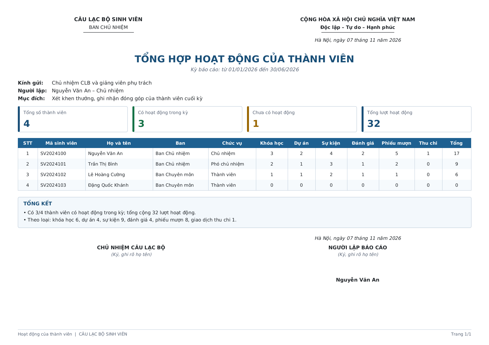

# Báo cáo module Thành viên

**Bài tập lớn môn Cơ sở dữ liệu: Hệ thống quản lý câu lạc bộ sinh viên**
Module trình bày: **Thành viên** (bản demo). Người thực hiện: Tú. Công nghệ: MySQL 8, Java 17, giao diện Swing.

Tài liệu gồm các mục 1, 3, 4, 5, 6, 7 theo tiêu chí chấm, kèm câu lệnh SQL ở phần phụ lục (mục 8). Mục 2 (mô hình thực thể liên kết) dùng hình ERD chung của nhóm, xem ghi chú ở mục 2.

---

## Mục 1. Mô tả tổng quan yêu cầu dữ liệu

### 1.1 Bài toán
Câu lạc bộ sinh viên cần quản lý hồ sơ của các thành viên: ai là thành viên, thuộc ban chuyên môn nào, giữ chức vụ gì, đang hoạt động hay đã rời, và được giao những quyền hạn nào trong hệ thống. Hồ sơ này là nền cho các hoạt động khác (khóa học, dự án, sự kiện, thu chi, mượn thiết bị, đánh giá): mọi hoạt động đều gắn với một thành viên cụ thể.

### 1.2 Người dùng hệ thống
| Người dùng | Việc cần làm với dữ liệu thành viên |
|---|---|
| Ban Chủ nhiệm (Chủ nhiệm, Phó chủ nhiệm, Thư ký) | Thêm, sửa, đổi trạng thái, xóa thành viên; cấp và thu hồi quyền hạn; tìm kiếm; lập báo cáo nhân sự |
| Thành viên | Xem danh sách công khai (họ tên, ban, chức vụ), không xem ngày sinh, email, số điện thoại của người khác |

### 1.3 Dữ liệu cần lưu trữ
| Nhóm dữ liệu | Thông tin cần lưu | Ghi chú |
|---|---|---|
| **Thành viên** | Mã sinh viên (MSV, duy nhất), họ và tên, ngày sinh, giới tính, email, số điện thoại, ngày gia nhập, trạng thái hoạt động, chức vụ trong ban | Mỗi thành viên có đúng một email và một số điện thoại |
| **Ban chuyên môn** | Mã ban (duy nhất), tên ban | Ví dụ: Ban Chủ nhiệm, Ban Chuyên môn, Ban Truyền thông, Ban Sự kiện, Ban Hậu cần |
| **Quyền hạn** | Mã quyền hạn (duy nhất), tên quyền hạn, mô tả chi tiết | Ví dụ: Quản trị hệ thống, Duyệt phiếu mượn, Quản lý tài chính |
| **Phân quyền** | Thành viên nào được cấp quyền hạn nào | Một thành viên có thể có nhiều quyền; một quyền có thể cấp cho nhiều thành viên |

Quan hệ giữa các dữ liệu: mỗi thành viên thuộc **đúng một** ban, một ban có **nhiều** thành viên; thành viên và quyền hạn có quan hệ **nhiều nhiều**.

### 1.4 Quy tắc nghiệp vụ
1. MSV bắt buộc, tối đa 20 ký tự, không trùng giữa các thành viên.
2. Họ và tên bắt buộc, tối đa 100 ký tự.
3. Giới tính nếu có chỉ nhận Nam, Nữ hoặc Khác.
4. Email nếu có phải đúng dạng `a@b.c`; số điện thoại nếu có gồm 9 đến 15 chữ số, có thể bắt đầu bằng `+`.
5. Ngày sinh và ngày gia nhập không được ở tương lai; ngày gia nhập không được trước ngày sinh.
6. Trạng thái chỉ nhận Đang hoạt động, Tạm nghỉ hoặc Đã rời CLB; để trống khi thêm thì mặc định Đang hoạt động.
7. Mỗi thành viên bắt buộc thuộc một ban đã tồn tại.
8. Chức vụ để trống khi thêm thì mặc định "Thành viên".
9. Thành viên đã có lịch sử hoạt động thì **không xóa**, chỉ đổi trạng thái thành Đã rời CLB để giữ lịch sử.
10. Không cấp một quyền hạn hai lần cho cùng một thành viên.

### 1.5 Chức năng nghiệp vụ liên quan đến dữ liệu
Thêm thành viên; sửa thông tin cá nhân; đổi trạng thái hoạt động; xóa thành viên (có điều kiện); tìm kiếm và xem chi tiết; xem lịch sử hoạt động của một thành viên (khóa học, dự án, sự kiện, đánh giá, phiếu mượn, thu chi); cấp và thu hồi quyền hạn; lập hai báo cáo (mục 7).

---

## Mục 2. Mô hình thực thể liên kết (tham chiếu)

Hình ERD đầy đủ của nhóm: `docs/erd/ERD_trang2_mo_hinh_ER.png`. Phần thuộc module Thành viên:

| Thành phần | Nội dung |
|---|---|
| Thực thể | **Thành viên** (khóa MSV), **Ban chuyên môn** (khóa Mã ban), **Quyền hạn** (khóa Mã quyền hạn) |
| Quan hệ "Thuộc về" | Ban chuyên môn 1 : N Thành viên; thành viên tham gia toàn phần (mỗi thành viên bắt buộc có ban); "Chức vụ" là thuộc tính của thành viên trong ban |
| Quan hệ "Có" | Thành viên M : N Quyền hạn |

---

## Mục 3. Mô hình dữ liệu quan hệ và mô tả bảng

### 3.1 Quy tắc chuyển từ mô hình thực thể liên kết sang mô hình quan hệ
1. Mỗi **thực thể** thành một bảng; thuộc tính khóa thành khóa chính.
2. Quan hệ **1 : N** (Ban chuyên môn : Thành viên) thành **khóa ngoại** đặt ở bảng phía N: `ThanhVien.MaBan` tham chiếu `BanChuyenMon.MaBan`. Vì thành viên tham gia toàn phần nên khóa ngoại này `NOT NULL`.
3. Quan hệ **M : N** (Thành viên : Quyền hạn) thành **bảng liên kết** `ThanhVien_QuyenHan` có khóa chính ghép (MSV, MaQuyenHan) và hai khóa ngoại.
4. Thuộc tính **đơn trị** (kể cả Email, Số điện thoại) thành một cột của bảng thực thể.
5. Các ràng buộc miền và ràng buộc liên thuộc tính thành `CHECK`; ràng buộc phức tạp hơn do thủ tục và trigger đảm nhiệm.

### 3.2 Lược đồ quan hệ
Khóa chính **in đậm**, khóa ngoại có dấu `#`.

- **BanChuyenMon**(**MaBan**, TenBan)
- **ThanhVien**(**MSV**, HoVaTen, NgaySinh, GioiTinh, Email, SDT, NgayGiaNhap, TrangThaiHD, #MaBan, ChucVu)
- **QuyenHan**(**MaQuyenHan**, TenQuyenHan, MoTaChiTiet)
- **ThanhVien_QuyenHan**(**#MSV**, **#MaQuyenHan**)



Ngoài ra bảng `ThanhVien` được các bảng khác tham chiếu qua `MSV` (hình phải): `ThamGiaKhoaHoc`, `ThamGiaDuAn`, `ThamGiaSuKien`, `ThuChi`, `DanhGia`, `PhieuMuon` (`MSVNguoiMuon`), `CoSoVatChat` (`MSVQuanLy`).

### 3.3 Mô tả các bảng (từ điển dữ liệu)

**Bảng `BanChuyenMon`: ban chuyên môn của câu lạc bộ**

| Cột | Kiểu | Ràng buộc | Ý nghĩa |
|---|---|---|---|
| MaBan | VARCHAR(20) | Khóa chính | Mã ban, ví dụ BAN01 |
| TenBan | VARCHAR(100) | NOT NULL | Tên ban |

**Bảng `ThanhVien`: hồ sơ thành viên**

| Cột | Kiểu | Ràng buộc | Ý nghĩa |
|---|---|---|---|
| MSV | VARCHAR(20) | Khóa chính | Mã sinh viên, ví dụ B21DCCN001 |
| HoVaTen | VARCHAR(100) | NOT NULL | Họ và tên |
| NgaySinh | DATE | | Ngày sinh |
| GioiTinh | VARCHAR(20) | | Nam, Nữ hoặc Khác |
| Email | VARCHAR(100) | | Email (đơn trị) |
| SDT | VARCHAR(20) | | Số điện thoại (đơn trị) |
| NgayGiaNhap | DATE | NOT NULL; CHECK `NgayGiaNhap >= NgaySinh` khi có ngày sinh | Ngày gia nhập câu lạc bộ |
| TrangThaiHD | VARCHAR(50) | | Đang hoạt động, Tạm nghỉ hoặc Đã rời CLB |
| MaBan | VARCHAR(20) | NOT NULL; khóa ngoại đến `BanChuyenMon(MaBan)`, UPDATE CASCADE, DELETE RESTRICT | Ban của thành viên |
| ChucVu | VARCHAR(100) | | Chức vụ trong ban |

**Bảng `QuyenHan`: danh mục quyền hạn**

| Cột | Kiểu | Ràng buộc | Ý nghĩa |
|---|---|---|---|
| MaQuyenHan | VARCHAR(20) | Khóa chính | Mã quyền, ví dụ QH02 |
| TenQuyenHan | VARCHAR(100) | NOT NULL | Tên quyền |
| MoTaChiTiet | TEXT | | Mô tả chi tiết |

**Bảng `ThanhVien_QuyenHan`: phân quyền (liên kết M : N)**

| Cột | Kiểu | Ràng buộc | Ý nghĩa |
|---|---|---|---|
| MSV | VARCHAR(20) | Khóa chính (ghép); khóa ngoại đến `ThanhVien(MSV)`, UPDATE CASCADE, DELETE CASCADE | Thành viên được cấp quyền |
| MaQuyenHan | VARCHAR(20) | Khóa chính (ghép); khóa ngoại đến `QuyenHan(MaQuyenHan)`, UPDATE CASCADE, DELETE CASCADE | Quyền được cấp |

Khóa chính ghép tự chặn việc cấp trùng một quyền cho cùng một thành viên. Câu lệnh `CREATE TABLE` đầy đủ ở phụ lục A.

---

## Mục 4. Kiểm tra chuẩn hóa 3NF

### 4.1 Tập phụ thuộc hàm
| Bảng | Phụ thuộc hàm |
|---|---|
| BanChuyenMon | MaBan → TenBan |
| ThanhVien | MSV → HoVaTen, NgaySinh, GioiTinh, Email, SDT, NgayGiaNhap, TrangThaiHD, MaBan, ChucVu |
| QuyenHan | MaQuyenHan → TenQuyenHan, MoTaChiTiet |
| ThanhVien_QuyenHan | Không có phụ thuộc hàm nào ngoài khóa: bảng chỉ gồm các thuộc tính khóa |

Giả định: chức vụ là chức vụ **của chính thành viên** (một người có một chức vụ), không do ban quyết định; Email và SĐT mỗi thành viên có một giá trị (theo ERD).

### 4.2 Kiểm tra từng dạng chuẩn
| Bảng | 1NF | 2NF | 3NF |
|---|---|---|---|
| BanChuyenMon | Giá trị nguyên tử | Khóa đơn, không có phụ thuộc một phần | Không có phụ thuộc bắc cầu |
| ThanhVien | Giá trị nguyên tử; Email, SĐT đơn trị, không có nhóm lặp | Khóa đơn MSV | Mọi thuộc tính không khóa phụ thuộc trực tiếp MSV; `TenBan` không lưu ở đây nên không có MSV → MaBan → TenBan |
| QuyenHan | Giá trị nguyên tử | Khóa đơn | Không có phụ thuộc bắc cầu |
| ThanhVien_QuyenHan | Giá trị nguyên tử | Không có thuộc tính không khóa | Đạt |

**Kết luận:** cả 4 bảng của module đều **đạt 3NF**, không cần tách thêm. Nếu nhóm cần BCNF thì vẫn đạt, vì mọi định thức (MSV, MaBan, MaQuyenHan) đều là khóa.

### 4.3 Quá trình đưa về 3NF (minh họa)
Thiết kế ban đầu gộp mọi thứ trong một bảng:

`ThanhVienGop`(MSV, HoVaTen, ..., MaBan, **TenBan**, **QuyenHan1, QuyenHan2, QuyenHan3**)

| Bước | Vấn đề | Cách xử lý |
|---|---|---|
| Về **1NF** | Cột `QuyenHan1, QuyenHan2, QuyenHan3` là nhóm lặp: một thành viên có số quyền không cố định | Tách thành bảng `ThanhVien_QuyenHan`(MSV, MaQuyenHan), mỗi quyền một dòng |
| Về **2NF** | Sau khi tách, bảng liên kết chỉ có thuộc tính khóa nên không có phụ thuộc một phần; muốn lưu tên quyền, mô tả thì chúng chỉ phụ thuộc MaQuyenHan (một phần của khóa ghép) | Tách tên và mô tả quyền ra bảng `QuyenHan`(MaQuyenHan, TenQuyenHan, MoTaChiTiet) |
| Về **3NF** | `MSV → MaBan → TenBan` là phụ thuộc bắc cầu: tên ban lặp lại ở mọi thành viên cùng ban, đổi tên ban phải sửa nhiều dòng | Tách `BanChuyenMon`(MaBan, TenBan); `ThanhVien` giữ `MaBan` làm khóa ngoại |

Hệ quả: đổi tên một ban chỉ sửa một dòng; thêm quyền mới không cần sửa cấu trúc bảng thành viên; không còn dữ liệu lặp.

### 4.4 Lựa chọn thiết kế cần lưu ý
- **Email, SĐT đơn trị:** nếu sau này cần nhiều email hoặc nhiều số điện thoại cho một thành viên thì phải tách thành bảng riêng (thuộc tính đa trị) để giữ 1NF. Nhóm chọn đơn trị theo ERD vì mỗi thành viên khai báo một liên hệ chính.
- **Miền giá trị trạng thái:** chỉ có ba giá trị cố định nên giữ ở cột kèm kiểm tra trong thủ tục; không cần bảng danh mục riêng.

---

## Mục 5. Hai màn hình nhập dữ liệu và kiểm tra tính đúng đắn

Cả hai màn hình đều nằm trong tab **Thành viên** của ứng dụng Swing. Dữ liệu nhập được kiểm tra ở **ba lớp**: giao diện (đọc ngày, ô bắt buộc), tầng nghiệp vụ Java (`ThanhVienService`) và cơ sở dữ liệu (thủ tục, khóa, `CHECK`). Lớp CSDL là hàng rào cuối cùng, bảo đảm dữ liệu sai không vào được dù đi bằng đường khác.

### 5.1 Màn hình nhập 1: Thêm thành viên (bảng `ThanhVien`)
Nút **Thêm thành viên** mở hộp thoại nhập 10 trường (dấu * là bắt buộc).



**Bộ ca kiểm tra** (thông báo là chính xác lời ứng dụng hiển thị):

| # | Dữ liệu nhập | Kết quả | Lớp chặn |
|---|---|---|---|
| 1 | MSV `B21DCCN901`, họ tên `Nguyễn Văn Mới`, ngày sinh `2004-03-01`, Nam, email `moi@example.com`, SĐT `0912345678`, ngày gia nhập `2026-11-07`, ban BAN02 | **Thành công**, thành viên xuất hiện trong bảng | |
| 2 | MSV để trống | "Mã sinh viên không được để trống." | Service |
| 3 | MSV dài 21 ký tự | "Mã sinh viên không được dài quá 20 ký tự." | Service |
| 4 | Họ tên để trống | "Họ và tên không được để trống." | Service |
| 5 | Họ tên dài 101 ký tự | "Họ và tên không được dài quá 100 ký tự." | Service |
| 6 | Ngày sinh ở tương lai | "Ngày sinh không được ở tương lai." | Service, thủ tục |
| 7 | Ngày sinh `2026-02-30` (không có thật) | "Ngày sinh cần có dạng yyyy-MM-dd và là ngày hợp lệ." | Giao diện |
| 8 | Giới tính `Robot` | "Giới tính phải là một trong: Nam, Nữ, Khác." | Service, thủ tục |
| 9 | Email `khong-hop-le` | "Email không hợp lệ." | Service, thủ tục |
| 10 | SĐT `12ab` | "Số điện thoại không hợp lệ (9 đến 15 chữ số, có thể bắt đầu bằng +)." | Service, thủ tục |
| 11 | Ngày gia nhập để trống | "Ngày gia nhập không được để trống." | Service |
| 12 | Ngày gia nhập trước ngày sinh | "Ngày gia nhập không được trước ngày sinh." | Service, thủ tục, `CHECK` |
| 13 | Trạng thái `Mất tích` | "Trạng thái phải là một trong: Đang hoạt động, Tạm nghỉ, Đã rời CLB." | Service, thủ tục |
| 14 | Chức vụ dài 101 ký tự | "Chức vụ không được dài quá 100 ký tự." | Service |
| 15 | MSV đã có (ví dụ `B21DCCN001`) | "Mã sinh viên đã tồn tại" | Thủ tục, khóa chính |
| 16 | Ban không có thật (ví dụ `BAN99`, khi gọi trực tiếp thủ tục) | "Ban chuyên môn không tồn tại" | Thủ tục, khóa ngoại |

Các ca sai **không để lại dòng nào** trong bảng. Ca 1 và 15 kiểm tra bằng cách thêm rồi thử thêm lại cùng MSV.

### 5.2 Màn hình nhập 2: Cấp và thu hồi quyền hạn (bảng `ThanhVien_QuyenHan`)
Chọn một thành viên, mở tab **Quyền hạn** ở nửa dưới. Bảng hiện các quyền thành viên đang có; ô **Cấp thêm quyền** chỉ liệt kê những quyền **chưa** có; nút **Cấp quyền** ghi một dòng vào bảng liên kết; nút **Thu hồi quyền đang chọn** xóa dòng sau khi hỏi xác nhận.



| # | Thao tác | Kết quả | Lớp chặn |
|---|---|---|---|
| 1 | Chọn QH02 trong ô, bấm Cấp quyền | **Thành công**, QH02 xuất hiện trong bảng và biến mất khỏi ô chọn | |
| 2 | Cấp quyền khi thành viên đã có đủ mọi quyền | "Không còn quyền nào để cấp cho thành viên này." | Giao diện |
| 3 | Cố cấp lại quyền đã có (gọi lại thủ tục) | "Mã đã tồn tại hoặc thành viên đã có quyền này." | Khóa chính ghép |
| 4 | Cấp quyền không có thật (gọi thủ tục với `QH99`) | "Quyền hạn không tồn tại" | Thủ tục, khóa ngoại |
| 5 | Cấp quyền cho MSV không có thật | "Thành viên không tồn tại" | Thủ tục, khóa ngoại |
| 6 | Bấm Thu hồi khi chưa chọn dòng | "Hãy chọn một quyền trong bảng Quyền hạn để thu hồi." | Giao diện |
| 7 | Thu hồi QH02, chọn Đồng ý | Dòng QH02 bị xóa, QH02 lại xuất hiện trong ô chọn | |
| 8 | Thu hồi quyền thành viên chưa có (gọi thủ tục) | "Thành viên chưa được cấp quyền này" | Thủ tục |

### 5.3 Cách kiểm tra tự động
- **Java** (không cần MySQL): `ThanhVienServiceTest` kiểm tra từng ca nhập sai ở bảng trên, `ThanhVienSwingUiTest` kiểm tra màn hình nạp dữ liệu, bộ lọc, cấp quyền. Chạy `mvn test`.
- **SQL:** file `sql/modules/01_thanhvien/tests.sql` tạo dữ liệu thử trong một giao dịch, thử 29 ca sai (đối chiếu đúng mã lỗi) và các ca đúng, rồi hoàn tác; kết quả mong đợi dòng `PASS module 01: dữ liệu thử đã rollback`. Kết quả chạy trên MySQL của nhóm: **[DÁN KẾT QUẢ SAU KHI CHẠY]**.

---

## Mục 6. Màn hình tìm kiếm

Tab **Quản lý thành viên** có thanh tìm kiếm ở trên cùng; kết quả hiện ngay trong bảng bên dưới; chọn một dòng thì nửa dưới hiện lịch sử hoạt động và quyền hạn của thành viên đó.



| Tiêu chí tìm | Cách hoạt động |
|---|---|
| Từ khóa | Khớp một phần **MSV hoặc họ tên**; để trống là bỏ qua. Việc so sánh theo kiểu `utf8mb4_unicode_ci` của CSDL nên không phân biệt hoa thường (và cũng bỏ qua dấu) |
| Ban | Danh sách thả xuống gồm "Tất cả ban" và các ban hiện có |
| Trạng thái | "Tất cả trạng thái", Đang hoạt động, Tạm nghỉ, Đã rời CLB |

Các tiêu chí kết hợp bằng phép **và**. Ví dụ tìm: từ khóa `Văn`, ban Ban Chuyên môn, trạng thái Đang hoạt động ra các thành viên có họ tên chứa "Văn" thuộc ban đó và đang hoạt động. Thanh trạng thái dưới cùng báo số kết quả; khi không có kết quả bảng để trống và báo 0 thành viên. Câu lệnh SQL ở phụ lục B.

---

## Mục 7. Hai báo cáo xem trên màn hình và xuất file

Tab **Báo cáo** (cạnh tab Quản lý thành viên) cho chọn báo cáo, nhập **người lập** (mặc định là người đang đăng nhập), chọn tham số, bấm **Xem báo cáo** để xem ngay trên màn hình đúng như trang in, rồi **Xuất PDF** để lưu file. File PDF khổ A4 nằm ngang, dùng chung một mẫu với báo cáo Mượn – Trả cơ sở vật chất (cùng đầu trang, thẻ thống kê, bảng, khối tổng kết và chữ ký); tiêu đề bảng lặp lại ở mỗi trang với báo cáo dài.

### 7.1 Báo cáo 1: Danh sách thành viên câu lạc bộ

| | |
|---|---|
| **Ai lập** | Thư ký câu lạc bộ (Ban Chủ nhiệm) |
| **Gửi cho ai** | Chủ nhiệm CLB; giảng viên phụ trách và Đoàn trường (đơn vị quản lý CLB) |
| **Dùng để làm gì** | Đăng ký danh sách thành viên sinh hoạt với đơn vị quản lý, thường vào đầu mỗi học kỳ |
| **Tham số** | Ban (hoặc tất cả), trạng thái (hoặc tất cả) |
| **Nội dung** | Bảng thành viên theo thứ tự ban, chức vụ (Chủ nhiệm đứng đầu), mã sinh viên; dòng tổng số thành viên, số thành viên theo ban và theo trạng thái; khối chữ ký Người lập, Chủ nhiệm |



Bản xuất ra PDF (ảnh trang in):



### 7.2 Báo cáo 2: Tổng hợp hoạt động của thành viên

| | |
|---|---|
| **Ai lập** | Ban Chủ nhiệm (người phụ trách nhân sự) |
| **Gửi cho ai** | Chủ nhiệm CLB và giảng viên phụ trách |
| **Dùng để làm gì** | Xét khen thưởng và ghi nhận đóng góp của thành viên cuối mỗi kỳ |
| **Tham số** | Từ ngày, đến ngày (kỳ báo cáo) |
| **Nội dung** | Với mỗi thành viên: số lần tham gia khóa học, dự án, sự kiện, số lần được đánh giá, số phiếu mượn, số giao dịch thu chi trong kỳ và tổng; thành viên nhiều hoạt động nhất xếp trước; dòng tổng hợp cuối bảng |

Báo cáo này lấy dữ liệu từ nhiều bảng (khóa học, dự án, sự kiện, đánh giá, phiếu mượn, thu chi) thông qua view `vw_LichSuHoatDong`.



Bản xuất ra PDF:



Hai file PDF mẫu nằm trong thư mục `mau-xuat/`. Số liệu trong ảnh là dữ liệu mẫu của dự án (`seed_master.sql` và `seed.sql` các module), chỉ để minh họa.

### 7.3 Cách xuất file
File `.pdf` được ghi trực tiếp bằng mã Java của dự án (lớp `common.BaoCaoPdf`, nhúng font DejaVu Sans để hiển thị đủ tiếng Việt), không cần cài thêm thư viện. Nội dung báo cáo được mô tả bằng `common.ReportSheet`, nên mọi báo cáo của dự án có cùng bố cục: tên đơn vị và quốc hiệu, tiêu đề, kỳ báo cáo, người lập, nơi nhận, mục đích, thẻ thống kê, bảng dữ liệu, tổng kết, khối chữ ký và số trang. Tên câu lạc bộ lấy từ `common.ThongTinClb` (đổi bằng biến môi trường `CLB_TEN_CLB`).

---

## Mục 8. Kết luận

### 8.1 Đối chiếu với tiêu chí
| Tiêu chí | Nội dung trong báo cáo | Sản phẩm trong dự án |
|---|---|---|
| 1. Yêu cầu dữ liệu | Mục 1 | Tài liệu này |
| 2. ERD | Mục 2 (tham chiếu hình chung) | `docs/erd/` |
| 3. Mô hình quan hệ, mô tả bảng | Mục 3 | `sql/00_schema/schema.sql`, hình `anh/mo_hinh_quan_he_thanh_vien.png` |
| 4. Chuẩn hóa 3NF | Mục 4 | Tài liệu này |
| 5. Hai màn hình nhập | Mục 5 | `src/main/thanhvien/ThanhVienSwingUi.java`; thủ tục `sp_ThemThanhVien`, `sp_CapQuyen` |
| 6. Màn hình tìm kiếm | Mục 6 | `ThanhVienSwingUi.java`; thủ tục `sp_TimThanhVien` |
| 7. Hai báo cáo xuất file | Mục 7 | `ThanhVienBaoCaoUi.java`, `BaoCaoThanhVien.java`, `common/BaoCaoPdf.java`, `common/ReportSheet.java`; thủ tục `sp_BaoCaoDanhSachThanhVien`, `sp_BaoCaoHoatDongThanhVien` |

### 8.2 Hạn chế hiện tại
- Chữ trong file PDF là ảnh (không bôi đen, sao chép được); nội dung báo cáo được lưu thêm trong thuộc tính của file để đối chiếu.
- Màn hình quyền hạn gọi lại các thủ tục của module Quyền hạn (do thành viên khác phụ trách).
- Số liệu báo cáo hoạt động phụ thuộc dữ liệu các module khác đã nhập.

---

## Phụ lục A. Câu lệnh tạo bảng

```sql
CREATE TABLE BanChuyenMon (
    MaBan  VARCHAR(20) PRIMARY KEY,
    TenBan VARCHAR(100) NOT NULL
);
```

```sql
CREATE TABLE ThanhVien (
    MSV         VARCHAR(20) PRIMARY KEY,
    HoVaTen     VARCHAR(100) NOT NULL,
    NgaySinh    DATE,
    GioiTinh    VARCHAR(20),
    Email       VARCHAR(100),
    SDT         VARCHAR(20),
    NgayGiaNhap DATE NOT NULL,
    TrangThaiHD VARCHAR(50),
    MaBan       VARCHAR(20) NOT NULL,
    ChucVu      VARCHAR(100),
    CONSTRAINT FK_ThanhVien_BanChuyenMon
        FOREIGN KEY (MaBan) REFERENCES BanChuyenMon(MaBan)
        ON UPDATE CASCADE ON DELETE RESTRICT,
    CONSTRAINT CK_ThanhVien_NgayGiaNhap
        CHECK (NgaySinh IS NULL OR NgayGiaNhap >= NgaySinh)
);
```

```sql
CREATE TABLE QuyenHan (
    MaQuyenHan  VARCHAR(20) PRIMARY KEY,
    TenQuyenHan VARCHAR(100) NOT NULL,
    MoTaChiTiet TEXT
);
```

```sql
CREATE TABLE ThanhVien_QuyenHan (
    MSV        VARCHAR(20),
    MaQuyenHan VARCHAR(20),
    PRIMARY KEY (MSV, MaQuyenHan),
    CONSTRAINT FK_TVQH_ThanhVien
        FOREIGN KEY (MSV) REFERENCES ThanhVien(MSV)
        ON UPDATE CASCADE ON DELETE CASCADE,
    CONSTRAINT FK_TVQH_QuyenHan
        FOREIGN KEY (MaQuyenHan) REFERENCES QuyenHan(MaQuyenHan)
        ON UPDATE CASCADE ON DELETE CASCADE
);
```

## Phụ lục B. Câu lệnh SQL của các màn hình và báo cáo

### B.1 Mục 5: màn hình nhập

Kiểm tra thông tin cá nhân (dùng chung cho thêm và sửa):

```sql
DROP PROCEDURE IF EXISTS sp_KiemTraThongTinCaNhan;
DELIMITER $$
CREATE PROCEDURE sp_KiemTraThongTinCaNhan(
    IN p_HoVaTen VARCHAR(255), IN p_NgaySinh DATE, IN p_GioiTinh VARCHAR(255),
    IN p_Email VARCHAR(255), IN p_SDT VARCHAR(255))
BEGIN
    DECLARE v_GioiTinh VARCHAR(255);
    DECLARE v_Email VARCHAR(255);
    DECLARE v_SDT VARCHAR(255);
    SET v_GioiTinh = NULLIF(TRIM(p_GioiTinh), '');
    SET v_Email = NULLIF(TRIM(p_Email), '');
    SET v_SDT = NULLIF(TRIM(p_SDT), '');
    IF p_HoVaTen IS NULL OR CHAR_LENGTH(TRIM(p_HoVaTen)) = 0 OR CHAR_LENGTH(TRIM(p_HoVaTen)) > 100 THEN
        SIGNAL SQLSTATE '45000' SET MESSAGE_TEXT = 'Họ và tên không hợp lệ (bắt buộc, tối đa 100 ký tự)';
    END IF;
    IF p_NgaySinh IS NOT NULL AND p_NgaySinh > CURDATE() THEN
        SIGNAL SQLSTATE '45000' SET MESSAGE_TEXT = 'Ngày sinh không được ở tương lai';
    END IF;
    IF v_GioiTinh IS NOT NULL AND v_GioiTinh NOT IN ('Nam', 'Nữ', 'Khác') THEN
        SIGNAL SQLSTATE '45000' SET MESSAGE_TEXT = 'Giới tính phải là Nam, Nữ hoặc Khác';
    END IF;
    IF v_Email IS NOT NULL AND (CHAR_LENGTH(v_Email) > 100 OR v_Email NOT LIKE '_%@_%._%') THEN
        SIGNAL SQLSTATE '45000' SET MESSAGE_TEXT = 'Email không hợp lệ';
    END IF;
    IF v_SDT IS NOT NULL AND v_SDT NOT REGEXP '^[+]?[0-9]{9,15}$' THEN
        SIGNAL SQLSTATE '45000' SET MESSAGE_TEXT = 'Số điện thoại không hợp lệ (9 đến 15 chữ số)';
    END IF;
END$$
DELIMITER ;
```

Thêm thành viên:

```sql
DROP PROCEDURE IF EXISTS sp_ThemThanhVien;
DELIMITER $$
CREATE PROCEDURE sp_ThemThanhVien(
    IN p_MSV VARCHAR(255), IN p_HoVaTen VARCHAR(255), IN p_NgaySinh DATE, IN p_GioiTinh VARCHAR(255),
    IN p_Email VARCHAR(255), IN p_SDT VARCHAR(255), IN p_NgayGiaNhap DATE,
    IN p_TrangThaiHD VARCHAR(255), IN p_MaBan VARCHAR(255), IN p_ChucVu VARCHAR(255))
BEGIN
    DECLARE v_MSV VARCHAR(255);
    DECLARE v_TrangThai VARCHAR(255);
    DECLARE v_MaBan VARCHAR(255);
    DECLARE v_ChucVu VARCHAR(255);
    SET v_MSV = TRIM(p_MSV);
    IF v_MSV IS NULL OR CHAR_LENGTH(v_MSV) = 0 OR CHAR_LENGTH(v_MSV) > 20 THEN
        SIGNAL SQLSTATE '45000' SET MESSAGE_TEXT = 'Mã sinh viên không hợp lệ (bắt buộc, tối đa 20 ký tự)';
    END IF;
    CALL sp_KiemTraThongTinCaNhan(p_HoVaTen, p_NgaySinh, p_GioiTinh, p_Email, p_SDT);
    IF p_NgayGiaNhap IS NULL THEN
        SIGNAL SQLSTATE '45000' SET MESSAGE_TEXT = 'Ngày gia nhập không được để trống';
    END IF;
    IF p_NgayGiaNhap > CURDATE() THEN
        SIGNAL SQLSTATE '45000' SET MESSAGE_TEXT = 'Ngày gia nhập không được ở tương lai';
    END IF;
    IF p_NgaySinh IS NOT NULL AND p_NgayGiaNhap < p_NgaySinh THEN
        SIGNAL SQLSTATE '45000' SET MESSAGE_TEXT = 'Ngày gia nhập không được trước ngày sinh';
    END IF;
    SET v_TrangThai = COALESCE(NULLIF(TRIM(p_TrangThaiHD), ''), 'Đang hoạt động');
    IF v_TrangThai NOT IN ('Đang hoạt động', 'Tạm nghỉ', 'Đã rời CLB') THEN
        SIGNAL SQLSTATE '45000' SET MESSAGE_TEXT = 'Trạng thái phải là Đang hoạt động, Tạm nghỉ hoặc Đã rời CLB';
    END IF;
    SET v_MaBan = TRIM(p_MaBan);
    IF v_MaBan IS NULL OR NOT EXISTS (SELECT 1 FROM BanChuyenMon WHERE MaBan = v_MaBan) THEN
        SIGNAL SQLSTATE '45000' SET MESSAGE_TEXT = 'Ban chuyên môn không tồn tại';
    END IF;
    SET v_ChucVu = NULLIF(TRIM(p_ChucVu), '');
    IF v_ChucVu IS NOT NULL AND CHAR_LENGTH(v_ChucVu) > 100 THEN
        SIGNAL SQLSTATE '45000' SET MESSAGE_TEXT = 'Chức vụ tối đa 100 ký tự';
    END IF;
    IF EXISTS (SELECT 1 FROM ThanhVien WHERE MSV = v_MSV) THEN
        SIGNAL SQLSTATE '45000' SET MESSAGE_TEXT = 'Mã sinh viên đã tồn tại';
    END IF;
    INSERT INTO ThanhVien(MSV, HoVaTen, NgaySinh, GioiTinh, Email, SDT, NgayGiaNhap, TrangThaiHD, MaBan, ChucVu)
    VALUES(v_MSV, TRIM(p_HoVaTen), p_NgaySinh, NULLIF(TRIM(p_GioiTinh), ''), NULLIF(TRIM(p_Email), ''),
           NULLIF(TRIM(p_SDT), ''), p_NgayGiaNhap, v_TrangThai, v_MaBan, COALESCE(v_ChucVu, 'Thành viên'));
END$$
DELIMITER ;
```

Cấp quyền và thu hồi quyền (module Quyền hạn):

```sql
DROP PROCEDURE IF EXISTS sp_CapQuyen;
DELIMITER $$
CREATE PROCEDURE sp_CapQuyen(IN p_MSV VARCHAR(255), IN p_MaQuyenHan VARCHAR(255))
BEGIN
    IF NOT EXISTS (SELECT 1 FROM ThanhVien WHERE MSV = TRIM(p_MSV)) THEN
        SIGNAL SQLSTATE '45000' SET MESSAGE_TEXT = 'Thành viên không tồn tại';
    END IF;
    IF NOT EXISTS (SELECT 1 FROM QuyenHan WHERE MaQuyenHan = TRIM(p_MaQuyenHan)) THEN
        SIGNAL SQLSTATE '45000' SET MESSAGE_TEXT = 'Quyền hạn không tồn tại';
    END IF;
    -- PK ghép là hàng rào cuối cùng chống cấp trùng, kể cả khi có hai kết nối đồng thời.
    INSERT INTO ThanhVien_QuyenHan(MSV, MaQuyenHan) VALUES(TRIM(p_MSV), TRIM(p_MaQuyenHan));
END$$
DELIMITER ;
DROP PROCEDURE IF EXISTS sp_ThuHoiQuyen;
DELIMITER $$
CREATE PROCEDURE sp_ThuHoiQuyen(IN p_MSV VARCHAR(255), IN p_MaQuyenHan VARCHAR(255))
BEGIN
    IF NOT EXISTS (SELECT 1 FROM ThanhVien WHERE MSV = TRIM(p_MSV)) THEN
        SIGNAL SQLSTATE '45000' SET MESSAGE_TEXT = 'Thành viên không tồn tại';
    END IF;
    IF NOT EXISTS (SELECT 1 FROM QuyenHan WHERE MaQuyenHan = TRIM(p_MaQuyenHan)) THEN
        SIGNAL SQLSTATE '45000' SET MESSAGE_TEXT = 'Quyền hạn không tồn tại';
    END IF;
    DELETE FROM ThanhVien_QuyenHan WHERE MSV = TRIM(p_MSV) AND MaQuyenHan = TRIM(p_MaQuyenHan);
    IF ROW_COUNT() = 0 THEN
        SIGNAL SQLSTATE '45000' SET MESSAGE_TEXT = 'Thành viên chưa được cấp quyền này';
    END IF;
END$$
DELIMITER ;
```

### B.2 Mục 6: màn hình tìm kiếm

```sql
DROP VIEW IF EXISTS vw_ThanhVienChiTiet;
CREATE VIEW vw_ThanhVienChiTiet AS
SELECT tv.MSV, tv.HoVaTen, tv.NgaySinh, tv.GioiTinh, tv.Email, tv.SDT,
       tv.NgayGiaNhap, tv.TrangThaiHD, tv.MaBan, b.TenBan, tv.ChucVu
FROM ThanhVien tv
JOIN BanChuyenMon b ON b.MaBan = tv.MaBan;
```

```sql
DROP PROCEDURE IF EXISTS sp_TimThanhVien;
DELIMITER $$
CREATE PROCEDURE sp_TimThanhVien(IN p_TuKhoa VARCHAR(255), IN p_MaBan VARCHAR(255), IN p_TrangThai VARCHAR(255))
BEGIN
    DECLARE v_TuKhoa VARCHAR(255);
    DECLARE v_MaBan VARCHAR(255);
    DECLARE v_TrangThai VARCHAR(255);
    SET v_TuKhoa = NULLIF(TRIM(p_TuKhoa), '');
    SET v_MaBan = NULLIF(TRIM(p_MaBan), '');
    SET v_TrangThai = NULLIF(TRIM(p_TrangThai), '');
    SELECT MSV, HoVaTen, NgaySinh, GioiTinh, Email, SDT, NgayGiaNhap, TrangThaiHD, MaBan, TenBan, ChucVu
    FROM vw_ThanhVienChiTiet
    WHERE (v_TuKhoa IS NULL OR LOCATE(v_TuKhoa, MSV) > 0 OR LOCATE(v_TuKhoa, HoVaTen) > 0)
      AND (v_MaBan IS NULL OR MaBan = v_MaBan)
      AND (v_TrangThai IS NULL OR TrangThaiHD = v_TrangThai)
    ORDER BY MSV;
END$$
DELIMITER ;
```

Lịch sử hoạt động và tổng quan của thành viên đang chọn:

```sql
DROP VIEW IF EXISTS vw_LichSuHoatDong;
CREATE VIEW vw_LichSuHoatDong AS
SELECT g.MSV, 'Khóa học' AS LoaiHoatDong, k.MaKhoaHoc AS MaHoatDong, k.TenKhoaHoc AS TenHoatDong,
       g.VaiTro AS ChiTiet, k.NgayKhaiGiang AS Ngay
FROM ThamGiaKhoaHoc g
JOIN KhoaHoc k ON k.MaKhoaHoc = g.MaKhoaHoc
UNION ALL
SELECT g.MSV, 'Dự án', d.MaDuAn, d.TenDuAn, g.VaiTro, d.NgayBatDau
FROM ThamGiaDuAn g
JOIN DuAn d ON d.MaDuAn = g.MaDuAn
UNION ALL
SELECT g.MSV, 'Sự kiện', s.MaSK, s.TenSK, g.VaiTro, s.NgayBatDau
FROM ThamGiaSuKien g
JOIN SuKien s ON s.MaSK = g.MaSK
UNION ALL
SELECT MSV, 'Đánh giá', MaGhiNhan, LoaiDanhGia, HinhThuc, NgayQuyetDinh
FROM DanhGia
UNION ALL
SELECT MSVNguoiMuon, 'Phiếu mượn', MaPhieuMuon, MucDichMuon, TrangThaiDuyet, NgayMuon
FROM PhieuMuon
UNION ALL
SELECT MSV, 'Thu chi', MaGD, MucDich, LoaiGD, DATE(ThoiGian)
FROM ThuChi
WHERE MSV IS NOT NULL;
```

```sql
DROP VIEW IF EXISTS vw_TongQuanThanhVien;
CREATE VIEW vw_TongQuanThanhVien AS
SELECT tv.MSV, tv.HoVaTen, tv.TrangThaiHD,
       (SELECT COUNT(*) FROM ThamGiaKhoaHoc g WHERE g.MSV = tv.MSV) AS SoKhoaHoc,
       (SELECT COUNT(*) FROM ThamGiaDuAn g WHERE g.MSV = tv.MSV) AS SoDuAn,
       (SELECT COUNT(*) FROM ThamGiaSuKien g WHERE g.MSV = tv.MSV) AS SoSuKien,
       (SELECT COUNT(*) FROM DanhGia d WHERE d.MSV = tv.MSV) AS SoDanhGia,
       (SELECT COUNT(*) FROM PhieuMuon p WHERE p.MSVNguoiMuon = tv.MSV) AS SoPhieuMuon
FROM ThanhVien tv;
```

```sql
DROP PROCEDURE IF EXISTS sp_LichSuHoatDongThanhVien;
DELIMITER $$
CREATE PROCEDURE sp_LichSuHoatDongThanhVien(IN p_MSV VARCHAR(255))
BEGIN
    DECLARE v_MSV VARCHAR(255);
    SET v_MSV = TRIM(p_MSV);
    IF v_MSV IS NULL OR NOT EXISTS (SELECT 1 FROM ThanhVien WHERE MSV = v_MSV) THEN
        SIGNAL SQLSTATE '45000' SET MESSAGE_TEXT = 'Thành viên không tồn tại';
    END IF;
    SELECT LoaiHoatDong, MaHoatDong, TenHoatDong, ChiTiet, Ngay
    FROM vw_LichSuHoatDong
    WHERE MSV = v_MSV
    ORDER BY Ngay DESC, LoaiHoatDong, MaHoatDong;
END$$
DELIMITER ;
```

```sql
DROP PROCEDURE IF EXISTS sp_TongQuanThanhVien;
DELIMITER $$
CREATE PROCEDURE sp_TongQuanThanhVien(IN p_MSV VARCHAR(255))
BEGIN
    DECLARE v_MSV VARCHAR(255);
    SET v_MSV = TRIM(p_MSV);
    IF v_MSV IS NULL OR NOT EXISTS (SELECT 1 FROM ThanhVien WHERE MSV = v_MSV) THEN
        SIGNAL SQLSTATE '45000' SET MESSAGE_TEXT = 'Thành viên không tồn tại';
    END IF;
    SELECT MSV, HoVaTen, TrangThaiHD, SoKhoaHoc, SoDuAn, SoSuKien, SoDanhGia, SoPhieuMuon
    FROM vw_TongQuanThanhVien WHERE MSV = v_MSV;
END$$
DELIMITER ;
```

### B.3 Mục 7: hai báo cáo

```sql
DROP PROCEDURE IF EXISTS sp_BaoCaoDanhSachThanhVien;
DELIMITER $$
CREATE PROCEDURE sp_BaoCaoDanhSachThanhVien(IN p_MaBan VARCHAR(255), IN p_TrangThai VARCHAR(255))
BEGIN
    DECLARE v_MaBan VARCHAR(255);
    DECLARE v_TrangThai VARCHAR(255);
    SET v_MaBan = NULLIF(TRIM(p_MaBan), '');
    SET v_TrangThai = NULLIF(TRIM(p_TrangThai), '');
    IF v_MaBan IS NOT NULL AND NOT EXISTS (SELECT 1 FROM BanChuyenMon WHERE MaBan = v_MaBan) THEN
        SIGNAL SQLSTATE '45000' SET MESSAGE_TEXT = 'Ban chuyên môn không tồn tại';
    END IF;
    IF v_TrangThai IS NOT NULL AND v_TrangThai NOT IN ('Đang hoạt động', 'Tạm nghỉ', 'Đã rời CLB') THEN
        SIGNAL SQLSTATE '45000' SET MESSAGE_TEXT = 'Trạng thái phải là Đang hoạt động, Tạm nghỉ hoặc Đã rời CLB';
    END IF;
    SELECT MSV, HoVaTen, NgaySinh, GioiTinh, Email, SDT, NgayGiaNhap, TrangThaiHD, MaBan, TenBan, ChucVu
    FROM vw_ThanhVienChiTiet
    WHERE (v_MaBan IS NULL OR MaBan = v_MaBan)
      AND (v_TrangThai IS NULL OR TrangThaiHD = v_TrangThai)
    ORDER BY MaBan,
             CASE ChucVu WHEN 'Chủ nhiệm' THEN 1 WHEN 'Phó chủ nhiệm' THEN 2
                         WHEN 'Trưởng ban' THEN 3 WHEN 'Phó ban' THEN 4 ELSE 5 END,
             MSV;
END$$
DELIMITER ;
```

```sql
DROP PROCEDURE IF EXISTS sp_BaoCaoHoatDongThanhVien;
DELIMITER $$
CREATE PROCEDURE sp_BaoCaoHoatDongThanhVien(IN p_TuNgay DATE, IN p_DenNgay DATE)
BEGIN
    IF p_TuNgay IS NULL OR p_DenNgay IS NULL THEN
        SIGNAL SQLSTATE '45000' SET MESSAGE_TEXT = 'Cần nhập cả từ ngày và đến ngày';
    END IF;
    IF p_DenNgay < p_TuNgay THEN
        SIGNAL SQLSTATE '45000' SET MESSAGE_TEXT = 'Đến ngày không được trước từ ngày';
    END IF;
    SELECT tv.MSV, tv.HoVaTen, b.TenBan, tv.ChucVu, tv.TrangThaiHD,
           COUNT(CASE WHEN h.LoaiHoatDong = 'Khóa học' THEN 1 END)  AS SoKhoaHoc,
           COUNT(CASE WHEN h.LoaiHoatDong = 'Dự án' THEN 1 END)     AS SoDuAn,
           COUNT(CASE WHEN h.LoaiHoatDong = 'Sự kiện' THEN 1 END)   AS SoSuKien,
           COUNT(CASE WHEN h.LoaiHoatDong = 'Đánh giá' THEN 1 END)  AS SoDanhGia,
           COUNT(CASE WHEN h.LoaiHoatDong = 'Phiếu mượn' THEN 1 END) AS SoPhieuMuon,
           COUNT(CASE WHEN h.LoaiHoatDong = 'Thu chi' THEN 1 END)   AS SoGiaoDich,
           COUNT(h.MaHoatDong) AS TongHoatDong
    FROM ThanhVien tv
    JOIN BanChuyenMon b ON b.MaBan = tv.MaBan
    LEFT JOIN vw_LichSuHoatDong h
           ON h.MSV = tv.MSV AND h.Ngay >= p_TuNgay AND h.Ngay <= p_DenNgay
    WHERE tv.NgayGiaNhap <= p_DenNgay
    GROUP BY tv.MSV, tv.HoVaTen, b.TenBan, tv.ChucVu, tv.TrangThaiHD
    ORDER BY TongHoatDong DESC, tv.MSV;
END$$
DELIMITER ;
```

