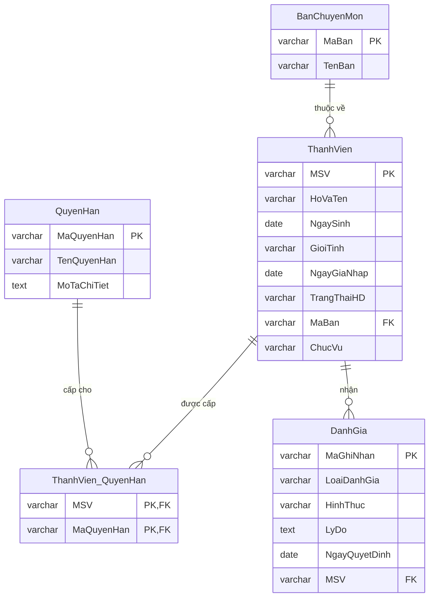

# Bổ sung mô hình quan hệ – phần Đông

[Sơ đồ SVG có thể chỉnh sửa](Mo_hinh_quan_he_nhan_su.svg) · [Ảnh PNG dùng trong báo cáo](Mo_hinh_quan_he_nhan_su.png)

Bản mô hình trang 3 hiện thiếu Quyền hạn, TV–Quyền hạn và Đánh giá. Sơ đồ này bổ sung đúng ba bảng đó và các liên kết tới Thành viên, Ban chuyên môn, theo schema đang có. Các bảng cơ sở vật chất và mượn trả thuộc phần Trường và không được thay đổi trong lần bàn giao này.

| Quan hệ | Khóa chính | Khóa ngoại |
|---|---|---|
| QuyenHan(MaQuyenHan, TenQuyenHan, MoTaChiTiet) | MaQuyenHan | — |
| ThanhVien_QuyenHan(MSV, MaQuyenHan) | (MSV, MaQuyenHan) | MSV → ThanhVien; MaQuyenHan → QuyenHan |
| DanhGia(MaGhiNhan, LoaiDanhGia, HinhThuc, LyDo, NgayQuyetDinh, MSV) | MaGhiNhan | MSV → ThanhVien |

- Thành viên ↔ Quyền hạn là N–N, chuyển thành hai quan hệ 1–N qua ThanhVien_QuyenHan; một cặp (MSV, MaQuyenHan) không lặp.
- Thành viên → Đánh giá là 1–N: thành viên có thể chưa có đánh giá, nhưng mọi đánh giá phải có MSV tồn tại.
- Ban chuyên môn → Thành viên là 1–N: ban có thể trống, mỗi thành viên bắt buộc thuộc một ban.
- Hai FK của bảng nối có ON DELETE CASCADE; FK DanhGia.MSV và ThanhVien.MaBan có ON DELETE RESTRICT. Tất cả FK trên đều có ON UPDATE CASCADE.

Sơ đồ tổng hợp theo Mermaid để tiện chỉnh sửa trong tài liệu:

